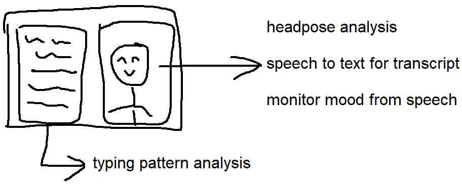

## Quick Checks
| Dir | Command (Alan's Web Services) |
| --- | --- |
| head-poses | curl -X POST -F file=@head-poses/data/image.jpg 104.52.63.66:7002 |
| image | curl -X POST -F file=@image/data/test1.png 104.52.63.66:7003 |
| voice | curl -X POST -F file=@voice/data/terry.mp3 104.52.63.66:7001 |

## Setup
See Docker-Checkout.md for running a pre-configured 11GB docker image  

| Hardware | Recommended |
| --- | --- |
| CPU | 1 core |
| RAM | 3 GB |
| Disk | 30 GB |

| Package | Ubuntu 24.04 or Ubuntu under WSL2 / AWS |
| --- | --- |
| core | sudo apt install ffmpeg python3-pip tesseract-ocr |
| base | pip3 install mediapipe tf-keras transformers torch openai-whisper pytesseract |
| server | pip3 install flask waitress |

## Reference Docs
| Repo | Link |
| --- | --- |
| head pose | https://ai.google.dev/edge/mediapipe/solutions/vision/face_landmarker |
| image to text | https://tesseract-ocr.github.io/tessdoc/Installation.html |
| text to mood | https://huggingface.co/SamLowe/roberta-base-go_emotions |
| voice to text | https://github.com/openai/whisper |

